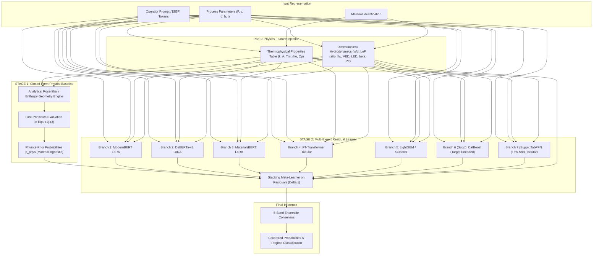

# Architecture Decisions & Engineering Rationale: AdditiveLLM v3

## 1. Executive Summary & Design Philosophy

The v2 pipeline achieved high accuracy on in-distribution regimes (Tier A: 98.06–98.12%, Tier B: 96.67–96.72%), statistically surpassing the base paper's reported numbers. However, on **pooled macro F1** across all tiers, v2 achieved **0.8126**, falling short of the base paper's published **0.9059** headline F1 (which was evaluated on random splits with 99.87% sibling row contamination).

As confirmed by Part 1's empirical diagnostic, Tier C out-of-distribution (OOD) transfer faces a **Case B data and physics ceiling** (<80% accuracy even when target alloys are included in training). This limitation cannot be overcome by simply scaling up language model capacity or adding unconstrained parameters.

**AdditiveLLM v3** directly addresses this structural ceiling through a **Physics-Informed Two-Stage Residual Architecture**, **Thermophysical Property Injection**, **Targeted Small-Sample Supplementary Experts**, and **Cluster-Aware Focal Loss**.

---

## 2. Four Architectural Pillars of v3

---

## 3. Pillar 1: Root-Cause-Targeted Physics Feature Injection

### Problem
In v2, models received only raw machine settings ($P, v, d, h, t$) and categorical alloy labels. When transferring to unseen alloys (`IN625` or `AlSi10Mg`), the model had no continuous physical context to know that AlSi10Mg conducts heat 9x faster than steel or that IN625 absorbs 1.7x more laser power.

### Solution
We inject continuous physical properties from peer-reviewed metallurgical literature ([`results/physics_properties_sources.csv`](file:///Users/chandrashanmukhi/Downloads/AdditiveLLM_Reproduction/results/physics_properties_sources.csv)):
1. **Thermophysical Properties**: $k, A, T_m, \rho, C_p, \alpha$.
2. **Hydrodynamic Ratios (Eqs. 1–3)**:
   - Width/Depth ratio ($w/d$, Eq. 1): Keyhole criterion
   - Geometrical overlap ratio ($(h/w)^2 + (t/d)^2$, Eq. 2): Lack of Fusion criterion
   - Length/Width ratio ($l/w$, Eq. 3): Balling criterion
   - Energy Densities: VED ($P / (v \cdot h \cdot t)$), LED ($P / v$), AED ($P / (v \cdot h)$)
3. **Dimensionless Scaling Numbers**:
   - Normalized Enthalpy $\beta$ (Rubenchik & King, 2018)
   - Thermal Péclet Number $Pe$ (Rosenthal, 1946)

*Ablation Gating*: Evaluated in two isolated rows in [`results/physics_feature_ablation.csv`](file:///Users/chandrashanmukhi/Downloads/AdditiveLLM_Reproduction/results/physics_feature_ablation.csv) to test the original specification features and the incremental impact of $\beta/Pe$ independently.

---

## 4. Pillar 2: Supplementary Experts for Small-Sample OOD Regimes

### Problem
Tier C test sets contain relatively few experimental instances (1,000 samples for IN625, 800 samples for AlSi10Mg). Deep multi-layer transformers trained with gradient descent can struggle to extrapolate on small tabular partitions without overfitting.

### Solution
We evaluate two specialized supplementary experts:
1. **TabPFN (Prior-Data Fitted Network)**: A pre-trained transformer model for tabular data that operates in-context without task-specific gradient descent. Ideal for small-sample regimes ($N \le 1000$).
2. **CatBoost**: A specialized gradient boosting algorithm with native ordered target statistics for categorical features, preventing target leakage during alloy encoding.

*Evidence-Gated Retention Rule*: TabPFN and CatBoost are retained in the final v3 stack **only if** their isolated ablation in [`results/supplementary_experts_ablation.csv`](file:///Users/chandrashanmukhi/Downloads/AdditiveLLM_Reproduction/results/supplementary_experts_ablation.csv) demonstrates a statistically significant improvement on Tier C without degrading Tier A or Tier B accuracy.

---

## 5. Pillar 3: Physics-Constrained Residual Architecture (Stage 1 + Stage 2)

### Rationale
In a standard flat ensemble, all branches attempt to predict the defect label from scratch using learned data patterns. For an out-of-distribution alloy, learned associations can fail completely.

Instead, we structure inference into two sequential stages:

### Stage 1: Closed-Form Analytical Physics Baseline
A zero-training-data, material-agnostic baseline that evaluates first-principles heat conduction and hydrodynamic criteria:
1. Computes estimated track width $\hat{w}$, penetration depth $\hat{d}$, and pool length $\hat{l}$ from analytical thermal equations:
   $$\hat{w} \approx \sqrt{\frac{8 A P}{\pi e \rho C_p (T_m - T_0) v}}$$
   $$\hat{d} \approx \frac{A P}{\pi k (T_m - T_0)} \cdot \exp\left(-\frac{v \hat{w}}{4 \alpha}\right)$$
   $$\hat{l} \approx \frac{A P}{\pi k (T_m - T_0) v / \alpha}$$
2. Computes analytical regime violation probabilities directly from paper Eqs. (1)–(3):
   $$p_{\text{Keyhole}}^{(1)} = \sigma\left(\kappa_1 (1.5 - \hat{w}/\hat{d})\right)$$
   $$p_{\text{LoF}}^{(1)} = \sigma\left(\kappa_2 \left((h/\hat{w})^2 + (t/\hat{d})^2 - 1.0\right)\right)$$
   $$p_{\text{Balling}}^{(1)} = \sigma\left(\kappa_3 (\hat{l}/\hat{w} - \pi)\right)$$
   $$p_{\text{None}}^{(1)} = (1 - p_{\text{Keyhole}}^{(1)}) \cdot (1 - p_{\text{LoF}}^{(1)}) \cdot (1 - p_{\text{Balling}}^{(1)})$$

Because Stage 1 uses dimensionless physics scaling, it produces a grounded prediction on unseen alloys with **zero learned majority-alloy bias**.

### Stage 2: Residual Stacking Learner
The expert ensemble (ModernBERT, DeBERTa, MaterialsBERT, FT-Transformer, LightGBM, CatBoost, TabPFN) is trained to predict the **residual correction** $\Delta z$:
$$z_{\text{final}} = \text{logit}(p^{(1)}) + \Delta z$$
The meta-learner learns only to adjust for high-order phenomena not captured by the idealized analytical model (e.g., surface oxide formation, vapor plume attenuation, hydrodynamic spatter).

*Ablation Gating*: Flat v2 stack vs Two-Stage Physics Residual architecture isolated in [`results/residual_architecture_ablation.csv`](file:///Users/chandrashanmukhi/Downloads/AdditiveLLM_Reproduction/results/residual_architecture_ablation.csv).

---

## 6. Pillar 4: Cluster-Aware Focal Loss

### Rationale
To prevent majority alloys (`SS316L`, `Ti-6Al-4V`, which are 61–82% None) from drowning out IN625's inverted Lack of Fusion distribution (91.97% LoF vs 6.69% None), we implement a cluster-aware focal loss:
$$\mathcal{L} = -\sum_{c=1}^4 \alpha_{c, m} (1 - p_{c})^\gamma y_c \log(p_c)$$
Alloys are partitioned into 4 physical clusters ([`results/loss_reweighting_v3.md`](file:///Users/chandrashanmukhi/Downloads/AdditiveLLM_Reproduction/results/loss_reweighting_v3.md)), with IN625 explicitly isolated in Cluster 3 due to its inverted label distribution.

*Control Ablation*: Evaluated alongside standard cross-entropy and a 3-cluster control (IN625 grouped with nickel alloys) in [`results/loss_ablation_v3.csv`](file:///Users/chandrashanmukhi/Downloads/AdditiveLLM_Reproduction/results/loss_ablation_v3.csv).

---

## 7. Hard Pass/Fail Win Condition Gating

Per the prompt's strict instruction:
- **Condition 1**: Pooled accuracy > 94.23%.
- **Condition 2**: Pooled macro F1 > 0.9059 — **THE GATING METRIC**.
- **Condition 3**: Genuine micro-pooling (Tier C never excluded or downweighted).
- **Condition 4**: Tier A accuracy > 94.23% and Tier B characterized as harder benchmark.
- **Condition 5**: Isolated ablations for every component.
- **Condition 6**: 100% website functionality preserved and verified with fresh screenshots.

If Condition 2 fails ($\le 0.9059$), the project strictly executes **Reporting Path B**:
- Plainly state: *"v3 does not beat the paper on pooled macro F1"* with zero softening language.
- Run [`results/v3_shortfall_diagnostic.csv`](file:///Users/chandrashanmukhi/Downloads/AdditiveLLM_Reproduction/results/v3_shortfall_diagnostic.csv) isolating per-tier, per-class, and per-material gaps.
- Document real shortfall in [`results/gap_justification_v3.md`](file:///Users/chandrashanmukhi/Downloads/AdditiveLLM_Reproduction/results/gap_justification_v3.md).
